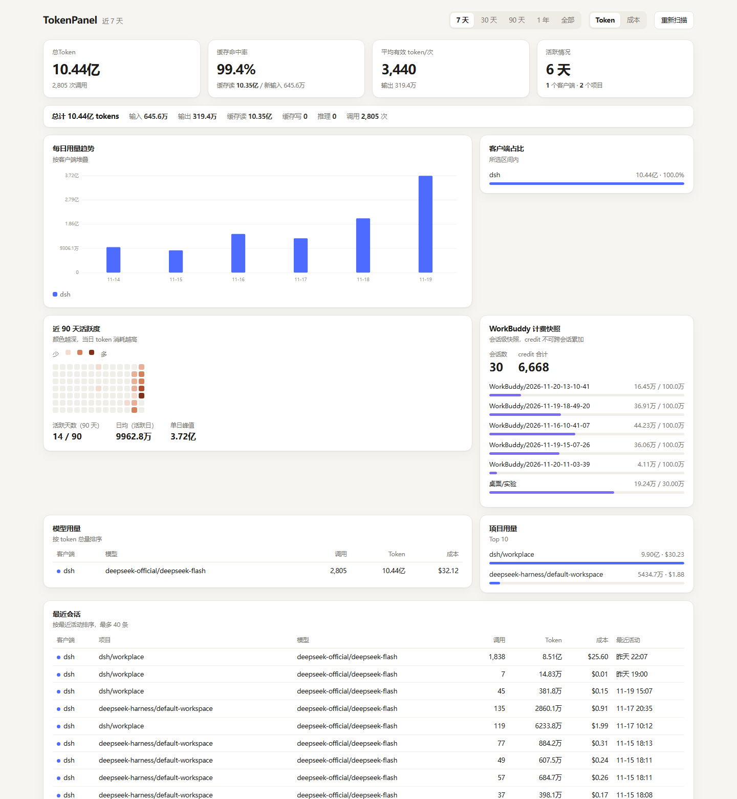

# TokenPanel

**自动检索本机所有 AI 客户端，把散落在各处的 token 用量汇总成一个可读的数字。**



你同时用着 Claude Code、Codex、OpenCode、dsh、WorkBuddy……每家的用量数据都躺在自己的目录里，格式互不兼容，官方面板各看各的。TokenPanel 把它们统一采集、去重、按同一口径量化，给出一个真实的总额：**这个月你到底烧了多少 token，花了多少钱。**

---

## 特性

- **自动发现**：扫描 `~` 与 `AppData`，按目录结构和文件指纹识别 harness，不依赖写死的清单
- **逐次精确**：能拿到逐条消息 usage 的，就精确到每一次 API 调用
- **中文计量**：所有数字按「万 / 亿」展示，不再对着 1,043,270,912 数零
- **零上报**：只读本地文件，不发任何网络请求，数据不出机器
- **零前端依赖**：原生 JS + SVG 手绘图表，无 CDN、无构建步骤，断网可用
- **可降级**：FastAPI 未安装时自动切换标准库 HTTP 服务，接口完全一致

## 支持的客户端

自动发现 10 类 harness，其中 5 类可量化：

| 客户端 | 数据源 | 采集粒度 | 成本来源 |
|---|---|---|---|
| **Claude Code** | `~/.claude/projects/**/*.jsonl` | 逐次调用（含缓存读写、thinking） | 价格表回算 |
| **dsh**（DeepSeek） | `~/.dsh/sessions/**/session.v4.jsonl.zstd` | 逐次调用（含缓存读写） | 价格表回算 |
| **OpenCode** | `~/.local/share/opencode/opencode.db` | 逐次调用 | 原生 `cost` 字段 |
| **Codex CLI** | `~/.codex/sessions/**/rollout-*.jsonl.zst` | 逐回合 | 价格表回算 |
| **WorkBuddy** | `~/.workbuddy/workbuddy.db` → `session_usage` | 会话级快照 | 原生 credit |

以下客户端会被自动发现，但**本地确实没有 token 记录**，因此如实标注为「仅发现」，不做估算：

| 客户端 | 原因 |
|---|---|
| Qoder | 会话日志无 `usage` 字段 |
| Trae / Cursor / Windsurf | 用量在云端 Dashboard |
| Copilot（CLI + VS Code 扩展） | 本地只有会话索引 |
| CodeBuddy | 日志未写入 usage |
| Marvis | 日志未写入 usage |

> 估算出来的假数字比没有数字更糟。宁可显示「不做」，也不猜。

## 快速开始

需要 Python 3.10+。

```bash
pip install zstandard        # 解析 dsh / Codex 的 zstd 会话必需
```

### 桌面客户端

双击 **`TokenPanel.vbs`**：静默启动、自动扫描、弹出独立窗口（用 Edge/Chrome 的 `--app` 模式，无地址栏，像个原生应用）。

需要看日志就用 **`TokenPanel.bat`**。

想打包成单个 exe：双击 `build_exe.bat`，产物在 `dist/TokenPanel.exe`。

### 命令行

```bash
python -m tokenpanel discover          # 检索本机 harness
python -m tokenpanel discover --deep   # 附带各目录体积
python -m tokenpanel scan              # 增量采集
python -m tokenpanel scan --force --recalc   # 全量重扫 + 按新价格重算
python -m tokenpanel report --days 30  # 终端报表
python -m tokenpanel desktop           # 桌面窗口
python -m tokenpanel serve --port 8765 # 仅启动网页服务
```

终端报表长这样：

```
=== 全量总账（累计） ===
客户端              调用       输入       输出      缓存读      缓存写       合计         成本
dsh            4067   924.7万   504.8万   13.80亿        0   13.94亿     $43.34
OpenCode       5983    1.48亿   299.5万    4.52亿    1.18万    6.03亿      $0.78
Claude Code      15       44   24.32万   38.18万   20.12万   82.62万     $22.58
合计                     1.57亿   828.7万   18.32亿   21.31万   19.97亿     $66.70

总计 19.97亿 tokens：输入 1.57亿 · 输出 828.7万 · 缓存读 18.32亿 · 缓存写 21.31万 · 推理 68.05万
```

## 计量口径

这是本项目最在意的部分。三类数据进入两张不同的表，**绝不混算**：

| 表 | 语义 | 累加规则 |
|---|---|---|
| `usage_event` | 一次模型调用一行 | 可累加 |
| `credit_snapshot` | 会话级累计值（WorkBuddy） | 只覆盖，不可累加 |

几个容易踩的坑，已处理：

- **Claude Code 流式重复**：同一 `message.id` 会写成多行，按 id 去重取最完整的一条，否则重复计数
- **Codex 累计值陷阱**：用 `last_token_usage` 而非 `total_token_usage`，且 `input_tokens` 已含缓存，需相减
- **dsh 多帧 zstd**：必须用流式解压，一次性 `decompress` 只能读到第一帧
- **Codex 文件后缀**：新版是 `.jsonl.zst`，不是 `.jsonl`
- **dsh 的 cwd 在顶层**：不在 `data` 里，取错就是全项目归属丢失
- **免费模型**：模型名含 `free` 的直接按 0 计价，避免把免费额度算成巨额成本
- **未定价模型**：显示「—」，不计入金额，并在面板列出待补清单

## 定价

编辑根目录 `pricing.json`，单位为 **USD / 1M tokens**：

```json
{
  "models": {
    "claude-opus":  { "input": 15.0, "output": 75.0, "cache_read": 1.5,  "cache_write": 18.75 },
    "deepseek-flash": { "input": 0.28, "output": 0.42, "cache_read": 0.028, "cache_write": 0.28 }
  }
}
```

匹配顺序：免费模型 → 精确 → 前缀 → 包含。改完执行：

```bash
python -m tokenpanel scan --recalc
```

## 架构

```
adapters/          每个客户端一个采集器，输出统一 schema
  claude.py  dsh.py  codex.py  opencode.py  workbuddy.py
        │
discovery.py  ── 扫描目录 + 指纹识别（结构 / sqlite 表名）
        │
ingest.py  ── 文件指纹增量 + 主键去重
        │
    SQLite  ── usage_event（可累加） / credit_snapshot（覆盖）
        │
pricing.py ── 价格表回算，未命中留空
        │
server_fallback.py（标准库） / server.py（FastAPI）
        │
   web/index.html ── 原生 JS + SVG，无 CDN
```

新增一个客户端只需实现 `adapters/base.py` 的 `Adapter`，在 `ingest.py` 注册，其余自动生效。

## 隐私

- 只读打开本地日志与数据库（sqlite 使用 `mode=ro`），不修改原始数据
- 无任何远程请求；打开页面时前端只访问 `127.0.0.1`
- `data/` 目录是纯派生数据，可随时删除重建

## 开发

```bash
python -m tokenpanel scan
python -m tokenpanel report
python -m tokenpanel serve --port 8765
```

可选安装 FastAPI（更快，但非必需）：

```bash
pip install fastapi uvicorn
```

## License

MIT
